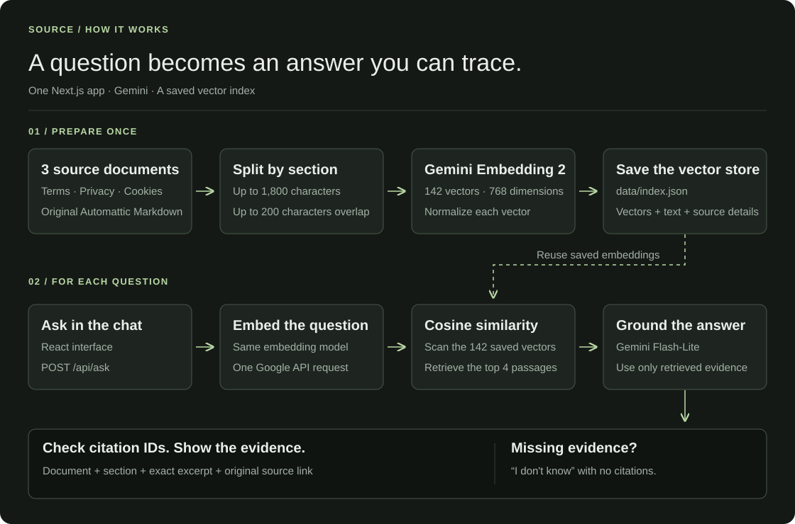
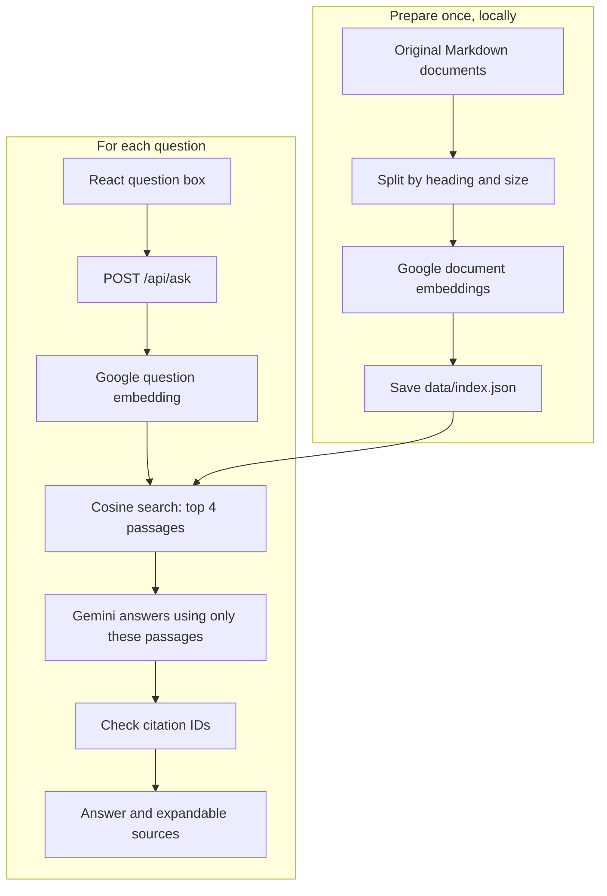
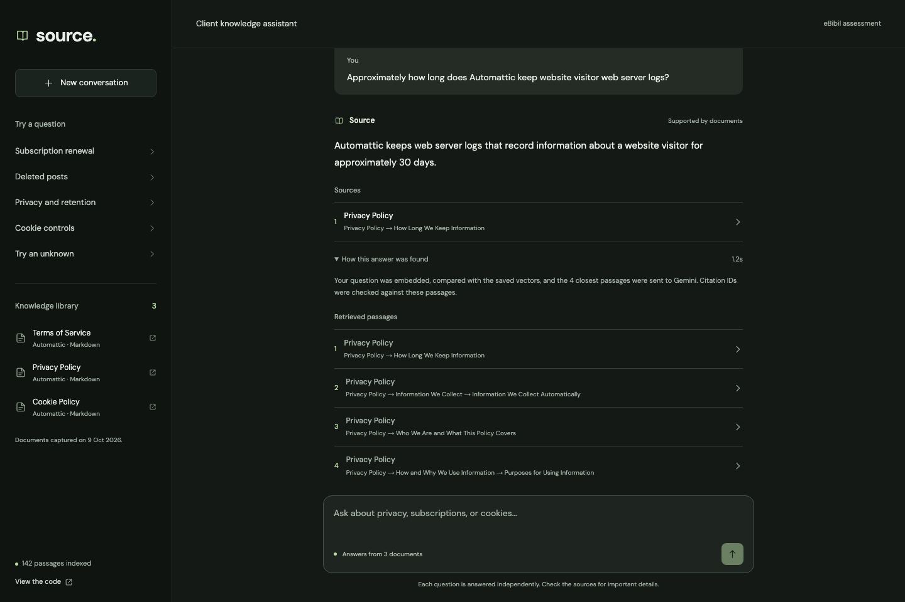

# Source — Client Knowledge Assistant

A small React chat app that answers questions from three public Automattic documents, shows its supporting passages, and says “I don’t know” when the documents lack an answer.

**[Try the demo](https://e-bibil-assistant.vercel.app)** · [Read the code](https://github.com/mitul-bhatia/E-Bibil_assignment)

| Source documents | Saved embeddings | Dimensions | Retrieved per question |
| :---: | :---: | :---: | :---: |
| **3** | **142** | **768** | **Top 4** |


## Run locally

Use Node.js 22 or newer and a Gemini API key from [Google AI Studio](https://aistudio.google.com/apikey).

```bash
git clone https://github.com/mitul-bhatia/E-Bibil_assignment.git
cd E-Bibil_assignment
npm ci
cp .env.example .env.local
```

Set `GEMINI_API_KEY` in `.env.local`, then:

```bash
npm run dev
```

Open http://localhost:3000. The repo contains the prepared document vectors; ordinary startup does not re-embed documents. A question still needs one Google embedding request and one answer request.

The default answer model is `gemini-3.5-flash-lite`. Google lists a [free tier](https://ai.google.dev/gemini-api/docs/pricing); actual access and quotas depend on your project. Keep the API key in `.env.local` locally and in Vercel environment variables when deployed. It is never a `NEXT_PUBLIC_` variable.

## Architecture

Next.js provides both the React interface and one server endpoint. A JSON file holds the vector index. There is no separate backend deployment or database service.



<details>
<summary>Editable architecture diagram</summary>



</details>

Start reading the code in this order:

| File | What it does |
| --- | --- |
| `lib/rag.js` | Embed the question, search, answer, and resolve sources |
| `lib/gemini.js` | Two Google HTTP calls with readable errors and one retry |
| `app/api/ask/route.js` | Validate the question and call `ask()` |
| `app/Chat.jsx` | Chat interface, examples, answer and source display |
| `lib/chunk.js` | Split Markdown into source-preserving passages |
| `scripts/prepare.mjs` | Generate and save the document vectors once |
| `data/index.json` | Prepared vectors, passage text and citation metadata |

## Documents and sources

The knowledge set is the original Automattic Markdown snapshot from [legalmattic revision 99aa482](https://github.com/Automattic/legalmattic/tree/99aa482bf6b602645bcb50c47a68db48a76dbce0), captured on 9 October 2026.

These links open the **exact original documents used to create the embeddings**, rather than a policy page that may change later:

| Document — Automattic original | Snapshot in this repo | Passages | Coverage |
| --- | --- | ---: | --- |
| [Terms of Service](https://github.com/Automattic/legalmattic/blob/99aa482bf6b602645bcb50c47a68db48a76dbce0/Terms%20of%20Service/WordPress.com/EN-Terms-of-Service.md) | [terms-of-service.md](documents/terms-of-service.md) | 71 | Accounts, age, subscriptions, payments and refunds |
| [Privacy Policy](https://github.com/Automattic/legalmattic/blob/99aa482bf6b602645bcb50c47a68db48a76dbce0/Privacy-Policy.md) | [privacy-policy.md](documents/privacy-policy.md) | 47 | Collection, retention, rights and security |
| [Cookie Policy](https://github.com/Automattic/legalmattic/blob/99aa482bf6b602645bcb50c47a68db48a76dbce0/Cookie-Policy.md) | [cookie-policy.md](documents/cookie-policy.md) | 24 | Cookie purposes and visitor controls |

For direct downloads: [Terms Markdown](https://raw.githubusercontent.com/Automattic/legalmattic/99aa482bf6b602645bcb50c47a68db48a76dbce0/Terms%20of%20Service/WordPress.com/EN-Terms-of-Service.md) · [Privacy Markdown](https://raw.githubusercontent.com/Automattic/legalmattic/99aa482bf6b602645bcb50c47a68db48a76dbce0/Privacy-Policy.md) · [Cookie Markdown](https://raw.githubusercontent.com/Automattic/legalmattic/99aa482bf6b602645bcb50c47a68db48a76dbce0/Cookie-Policy.md).

[data/sources.json](data/sources.json) records original URLs, revision and SHA-256 hashes. Documents are by [Automattic](https://github.com/Automattic/legalmattic) under [CC BY-SA 4.0](https://creativecommons.org/licenses/by-sa/4.0/); the licence is included in [documents/LICENSE.txt](documents/LICENSE.txt). Linked pages are not indexed. These are Markdown documents, so citations show a document and section rather than a PDF page.

## Chunking and retrieval

Chunking is deterministic: recognize Markdown headings, split long sections at paragraph or word boundaries, cap passages at 1,800 characters, and overlap up to 200 characters inside the same section. This preserves nearby context without asking an LLM to preprocess the documents. Passages are exact slices of the original text.

The prepared index has **142 passages** and **768-dimensional `gemini-embedding-2` vectors**. Document embeddings include their title and section. Question embeddings use the question-answering task prefix documented by [Google](https://ai.google.dev/gemini-api/docs/embeddings).

**Vector store verified:** all 142 passages have a unique, finite, normalized vector; none are missing. Indexed passage text and document hashes match the original snapshot. The saved index is approximately 2.40 MiB. See [data/index-summary.json](data/index-summary.json) for the recorded integrity check. The full [data/index.json](data/index.json) is bundled with the server endpoint; the browser receives passage text and sources, without the vector arrays.

Both vectors are normalized, so their dot product is cosine similarity. Sort the scores and take the top four. For this small corpus, a direct scan is easy to inspect and requires no FAISS installation or hosted vector database. Scores rank evidence; they are not confidence percentages or an answerability threshold.

The answer prompt allows only retrieved evidence, preserves product scope and exceptions, and asks the model to abstain when evidence is missing. Citation IDs must belong to the retrieved passages; titles, URLs and excerpts come from saved metadata. Valid IDs alone do not prove factual support, so answers also need evaluation against the original passages.

To regenerate the index after changing documents:

```bash
npm run prepare:index
```

The script verifies source hashes, saves completed embeddings in an ignored cache, and replaces the index only after every document succeeds. Update the manifest when intentionally changing a source. Preparation is not part of the Vercel build.

## Visual walkthrough

Sample questions are stored in `data/examples.json` and shipped with the app. Click one to submit it. Each turn is an independent question; previous chat messages are not sent to the model.

**1. Ask a question and open the supporting source.** The title, section, original link and exact excerpt make the answer inspectable.


**2. Expand “How this answer was found”.** See the four retrieved passages and the time taken. A citation identifies evidence; it is not a confidence percentage.



**3. Try an unknown question, including on mobile.** Private refund dates and current prices are outside these documents, so the app abstains and shows no supporting citations.

<p align="center"></p>

## Verify through the live demo

Open [the deployed chat](https://e-bibil-assistant.vercel.app), enter the questions from [data/eval_questions.json](data/eval_questions.json), and inspect the actual answers and excerpts. These are eight answerable questions and two unanswerable questions. Expected answers are static review notes and are never used by the RAG backend.

The repository contains no automated test suite or evaluation runner. Verification is through the deployed UI. [data/eval_results.json](data/eval_results.json) contains the actual recorded browser responses, citations, timings and Codex-assisted review notes; it is evidence, not executable test code.

**Recorded browser run:** 10/10 questions completed with `gemini-3.5-flash-lite`. Review marked 9 pass and 1 fail against the expected facts and cited passages. Both unanswerable questions correctly abstained. Each response showed four retrieved passages, and returned source metadata matched the saved index. Desktop and mobile had no browser runtime errors or horizontal overflow. This describes this small set, not general accuracy; the applicant should also review the results.

| ID | Question | Expected key facts | Actual result / review |
| --- | --- | --- | --- |
| Q1 | Minimum age and Europe | 13; 16 in Europe; guardian supervision below majority | Correct ages, omitted supervision — fail |
| Q2 | Cancellation before renewal | One month annual; 24 hours shorter periods | Both deadlines correct — pass |
| Q3 | Promotional renewal price | Full price after the discount | Correct — pass |
| Q4 | Independent website refund | Contact the website owner | Correct — pass |
| Q5 | Refund guarantee | No blanket guarantee; policy and legal exceptions | Correct — pass |
| Q6 | Visitor log retention | Approximately 30 days | Correct — pass |
| Q7 | Deleted posts and backups | 30 days in Trash; backups may remain until purged | Both facts correct — pass |
| Q8 | Browser cookies and features | Can reject cookies; some features may fail | Correct with a valid Privacy Policy citation — pass |
| Q9 | My refund arrival date | Documents cannot answer | Correct abstention — pass |
| Q10 | Current Business price in INR | Documents cannot answer | Correct abstention — pass |

Q1 is a generation completeness miss: retrieval found the full age section, including the supervision condition. A next improvement is to include all relevant policy qualifications while keeping answers short. Q8 has a valid alternative source: the Privacy Policy also states the cookie rule, although the review question names the Cookie Policy. No expected answers are substituted for model outputs.

## Deploy to Vercel

1. Import this repository into Vercel using the Next.js preset.
2. Add `GEMINI_API_KEY` as an encrypted server environment variable. Optionally set `GEMINI_MODEL`.
3. Deploy. The committed `data/index.json` is included with the server endpoint.
4. Try an answerable question and “Try an unknown” from the deployed sidebar.

`npm run build` builds both the UI and endpoint. No Python, PyTorch, model download or separate service is needed on Vercel.

## Limits and next steps

- Policies are a fixed snapshot, not current prices or private account data.
- Top-four retrieval can miss evidence or conditions spread across passages.
- Gemini can still make an unsupported claim with a valid source ID; read the excerpt.
- Google quota and service failures affect availability. The backend retries a transient error once, then shows an error rather than a document-based abstention.
- This public assessment demo has no login, uploads or per-user quota controls. Add those only if expanding beyond a small demo.
- Next steps: inspect evaluation misses, improve retrieval only where needed, and test more paraphrases and multi-part questions.

## AI tools and time spent

OpenAI Codex assisted with document research, the original Python prototype, this JavaScript simplification, UI, browser verification, documentation and deployment. Google Gemini Embedding 2 generated the saved document vectors; Gemini Flash-Lite produces runtime answers. The applicant should understand and be able to change each part during the interview.

Estimated assisted-session elapsed time: about 3 hours 20 minutes, from approximately 16:16 to 19:35 IST on 9 October 2026, including pauses and provider waiting. The session covered the original prototype review, JavaScript migration, embeddings, UI, live browser verification, documentation and deployment checks. This is a session estimate, not a claim of independent applicant effort.
