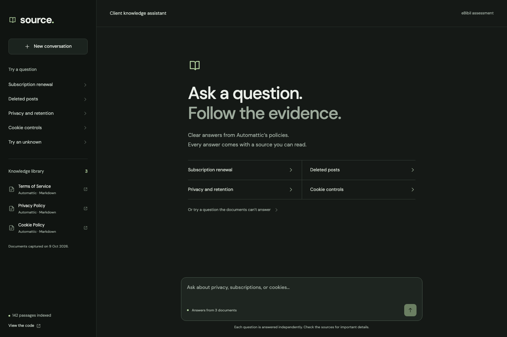
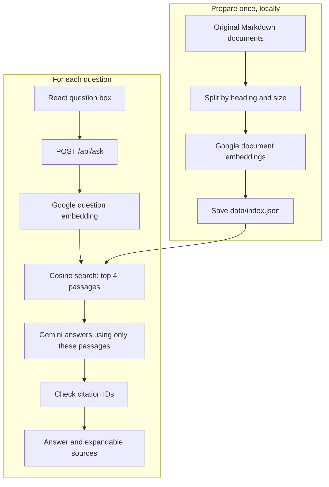
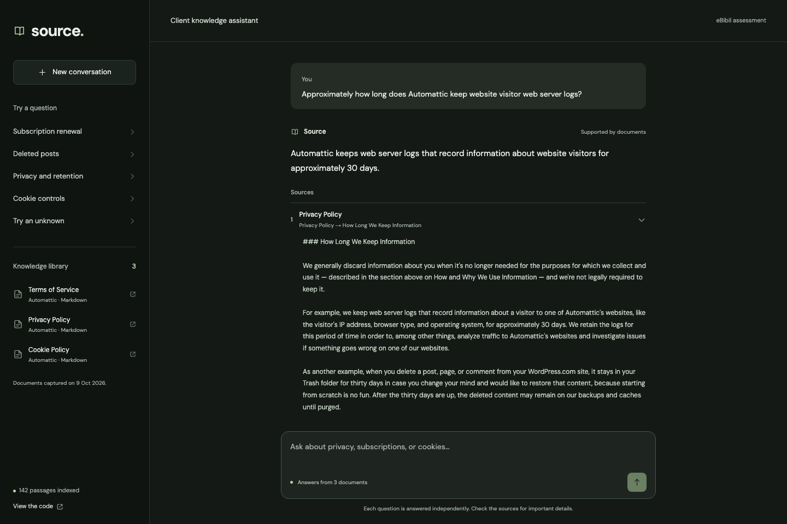
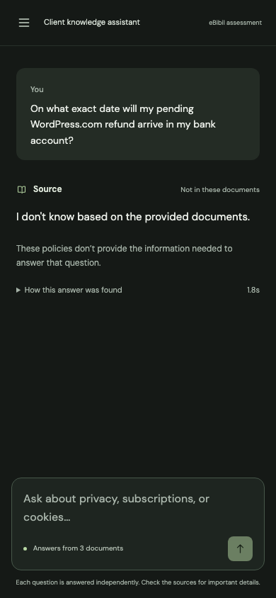

# Source — Client Knowledge Assistant

A small React chat app that answers questions from three public Automattic documents, shows its supporting passages, and says “I don’t know” when the documents lack an answer.

**[Try the demo](https://e-bibil-assistant.vercel.app)** · [Read the code](https://github.com/mitul-bhatia/E-Bibil_assignment)



## Run locally

Use Node.js 22 or newer and a Gemini API key from [Google AI Studio](https://aistudio.google.com/apikey).

```bash
git clone https://github.com/mitul-bhatia/E-Bibil_assignment.git
cd E-Bibil_assignment
npm ci
cp .env.example .env.local
```

Set `GEMINI_API_KEY` in `.env.local`, then:

```bash
npm run dev
```

Open http://localhost:3000. The repo contains the prepared document vectors; ordinary startup does not re-embed documents. A question still needs one Google embedding request and one answer request.

The default answer model is `gemini-3.5-flash-lite`. Google lists a [free tier](https://ai.google.dev/gemini-api/docs/pricing); actual access and quotas depend on your project. Keep the API key in `.env.local` locally and in Vercel environment variables when deployed. It is never a `NEXT_PUBLIC_` variable.

## Architecture

Next.js provides both the React interface and one server endpoint. A JSON file holds the vector index. There is no separate backend deployment or database service.



Start reading the code in this order:

| File | What it does |
| --- | --- |
| `lib/rag.js` | Embed the question, search, answer, and resolve sources |
| `lib/gemini.js` | Two Google HTTP calls with readable errors and one retry |
| `app/api/ask/route.js` | Validate the question and call `ask()` |
| `app/Chat.jsx` | Chat interface, examples, answer and source display |
| `lib/chunk.js` | Split Markdown into source-preserving passages |
| `scripts/prepare.mjs` | Generate and save the document vectors once |
| `scripts/evaluate.mjs` | Run the ten questions and save actual results |

## Documents and sources

The knowledge set is the original Automattic Markdown snapshot from [legalmattic revision 99aa482](https://github.com/Automattic/legalmattic/tree/99aa482bf6b602645bcb50c47a68db48a76dbce0), captured on 9 October 2026.

| Document | Coverage |
| --- | --- |
| Terms of Service | Accounts, age requirements, payments, subscriptions and refunds |
| Privacy Policy | Collection, retention, privacy rights and security |
| Cookie Policy | Cookie purposes and visitor controls |

`data/sources.json` records original URLs, revision and SHA-256 hashes. Documents are by Automattic under [CC BY-SA 4.0](https://creativecommons.org/licenses/by-sa/4.0/); the licence is included in `documents/LICENSE.txt`. Linked pages are not indexed. These are Markdown documents, so citations show a document and section rather than a PDF page.

## Chunking and retrieval

Chunking is deterministic: recognize Markdown headings, split long sections at paragraph or word boundaries, cap passages at 1,800 characters, and overlap up to 200 characters inside the same section. This preserves nearby context without asking an LLM to preprocess the documents. Passages are exact slices of the original text.

The prepared index has **142 passages** and **768-dimensional `gemini-embedding-2` vectors**. Document embeddings include their title and section. Question embeddings use the question-answering task prefix documented by [Google](https://ai.google.dev/gemini-api/docs/embeddings).

Both vectors are normalized, so their dot product is cosine similarity. Sort the scores and take the top four. For this small corpus, a direct scan is easy to inspect and requires no FAISS installation or hosted vector database. Scores rank evidence; they are not confidence percentages or an answerability threshold.

The answer prompt allows only retrieved evidence, preserves product scope and exceptions, and asks the model to abstain when evidence is missing. Citation IDs must belong to the retrieved passages; titles, URLs and excerpts come from saved metadata. Valid IDs alone do not prove factual support, so answers also need evaluation against the original passages.

To regenerate the index after changing documents:

```bash
npm run prepare:index
```

The script verifies source hashes, saves completed embeddings in an ignored cache, and replaces the index only after every document succeeds. Update the manifest when intentionally changing a source. Preparation is not part of the Vercel build.

## Demo and evaluation

Sample questions are stored in `data/examples.json` and shipped with the app. Click one to submit it. Each turn is an independent question; previous chat messages are not sent to the model.



The assessment test set is `data/eval_questions.json`: eight answerable questions and two unanswerable questions. Expected answers are never used by the RAG backend.

```bash
npm run evaluate
```

Actual answers, citations, answerability checks, timing and review notes are saved in `data/eval_results.json`. The script waits 15 seconds between questions to reduce quota failures. Automated section matches are not an accuracy score; review `actual_answer` against `expected_answer` and the cited passage.

**Recorded live run:** 10/10 questions completed with `gemini-3.5-flash-lite`. Codex-assisted review marked 9 pass and 1 fail against the expected answers and actual cited passages. Both unanswerable questions correctly abstained. This describes this small test set, not general accuracy; the applicant should also review the results.

| ID | Question | Expected key facts | Actual result / review |
| --- | --- | --- | --- |
| Q1 | Minimum age and Europe | 13; 16 in Europe; guardian supervision below majority | Correct ages, omitted supervision — fail |
| Q2 | Cancellation before renewal | One month annual; 24 hours shorter periods | Both deadlines correct — pass |
| Q3 | Promotional renewal price | Full price after the discount | Correct — pass |
| Q4 | Independent website refund | Contact the website owner | Correct — pass |
| Q5 | Refund guarantee | No blanket guarantee; policy and legal exceptions | Correct — pass |
| Q6 | Visitor log retention | Approximately 30 days | Correct — pass |
| Q7 | Deleted posts and backups | 30 days in Trash; backups may remain until purged | Both facts correct — pass |
| Q8 | Browser cookies and features | Can reject cookies; some features may fail | Correct with a valid Privacy Policy citation — pass |
| Q9 | My refund arrival date | Documents cannot answer | Correct abstention — pass |
| Q10 | Current Business price in INR | Documents cannot answer | Correct abstention — pass |

Q1 is a generation completeness miss: retrieval found the full age section, including the supervision condition. A next improvement is to include all relevant policy qualifications while keeping answers short. Q8 exposes a limitation of the automated evaluation: the Privacy Policy also states the cookie rule, so an expected-document match can flag a valid citation as a miss. Review notes explain both cases.

An earlier `gemini-3.8-flash` run completed only 4/10 questions because of provider/quota failures; its unchanged report is saved in `data/eval_previous.json`. Flash-Lite was selected after a live abstention test returned in about 2.5 seconds, then the entire same test set was rerun. No expected answers are substituted for model outputs.



## Deploy to Vercel

1. Import this repository into Vercel using the Next.js preset.
2. Add `GEMINI_API_KEY` as an encrypted server environment variable. Optionally set `GEMINI_MODEL`.
3. Deploy. The committed `data/index.json` is included with the server endpoint.
4. Try an answerable question and “Try an unknown” from the deployed sidebar.

`npm run build` builds both the UI and endpoint. No Python, PyTorch, model download or separate service is needed on Vercel.

## Checks, limits and next steps

```bash
npm test
npm run build
```

Five offline tests check source-preserving chunking, overlap, cosine ranking, citation restrictions and API input validation. They do not establish live model accuracy.

- Policies are a fixed snapshot, not current prices or private account data.
- Top-four retrieval can miss evidence or conditions spread across passages.
- Gemini can still make an unsupported claim with a valid source ID; read the excerpt.
- Google quota and service failures affect availability. The backend retries a transient error once, then shows an error rather than a document-based abstention.
- This public assessment demo has no login, uploads or per-user quota controls. Add those only if expanding beyond a small demo.
- Next steps: inspect evaluation misses, improve retrieval only where needed, and test more paraphrases and multi-part questions.

## AI tools and time spent

OpenAI Codex assisted with document research, the original Python prototype, this JavaScript simplification, UI, tests and deployment. Google Gemini Embedding 2 generated the saved document vectors; Gemini Flash produces runtime answers. The applicant should understand and be able to change each part during the interview.

Estimated assisted session time: about 1 hour 40 minutes, from approximately 16:16 to 17:56 IST on 9 October 2026. This includes the original prototype review, JavaScript migration, document embeddings, UI, tests and deployment checks. This is a session estimate, not a claim of independent applicant effort.
